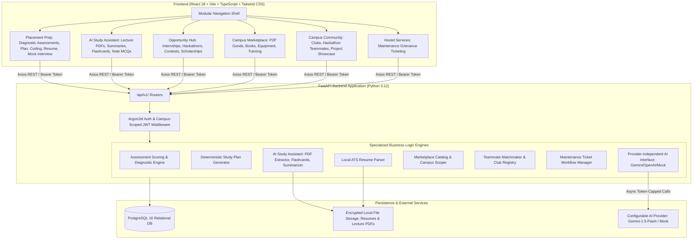

# PlacementPilot — Comprehensive System Architecture & Design Blueprint

> **Unified Platform Scope:** Placement Preparation + Academic AI Assistant + Campus Super-App  
> **Target Audience:** Engineering Students, Campus Clubs, and College Administration

---

## 1. Unified System Architecture Diagram

---

## 2. Pillar Architecture & Data Flow

### Pillar 1: AI Study Assistant 📚
- **PDF Ingestion:** Uses local `pypdf` extraction (max 15MB) with sanitized UUID storage.
- **Deterministic Summarization:** Key concept extraction, heading hierarchical breakdown, and term frequency index.
- **AI Enrichment (Optional):** When an API key is present, generates executive takeaways, conceptual flashcard Q&As, and lecture-specific practice MCQs.

### Pillar 2: Opportunity Hub 💼
- **Universal Listing Registry:** Classified by `internship`, `hackathon`, `competition`, `research`, `scholarship`, and `placement_prep`.
- **Eligibility Filter:** Normalized filtering by graduation year, branch, and minimum CGPA.
- **Student Pipeline:** Individualized tracking state machine: `Interested` $\rightarrow$ `Applied` $\rightarrow$ `Shortlisted` $\rightarrow$ `Interview` $\rightarrow$ `Offer` / `Rejected`.

### Pillar 3: Campus Marketplace 🛒
- **Trust Isolation:** Listings are automatically scoped to the student's registered `campus_name` to ensure safety and localized peer-to-peer exchanges.
- **Categories:** Books, scientific calculators, lab coats/kits, furniture, and peer tutoring.
- **Direct Contact:** Configurable direct contact methods (Campus Email, Phone, Hostel Room) without middleman fees.

### Pillar 4: Campus Community & Collaboration 🎓
- **Club Directory:** Discover technical and cultural clubs with coordinator contacts.
- **Hackathon Teammate Finder:** Post team requests with specific skill gaps (*e.g., "Need UI/UX designer for SIH 2026"*).
- **Project Showcase:** Feed for sharing open-source projects, research ideas, and campus event announcements.

### Pillar 5: Hostel & Campus Facility Services 🏠
- **Grievance Ticketing:** Issue submission with photo attachment, location (*Hostel Block, Room/Area*), and category (*Water, Electricity, WiFi, Cleanliness*).
- **Status Lifecycle:** `Open` $\rightarrow$ `Acknowledged` $\rightarrow$ `In Progress` $\rightarrow$ `Resolved`.
- **Audit Log:** Staff resolution notes and student acknowledgment.

---

## 3. Security, Privacy & Campus Scoping

1. **Authentication:** Salted **Argon2id** password hashing.
2. **Campus Multi-Tenancy:** Each student profile includes a verified `campus_name`. Marketplace listings, facility tickets, and club registries query within the student's campus scope to maintain safety.
3. **Data Protection:** Personal contact information is only exposed to authenticated, campus-verified peers for marketplace transactions.
4. **File Isolation:** Uploaded lecture PDFs and student resumes are strictly sandboxed outside public web roots with UUID identifiers.
