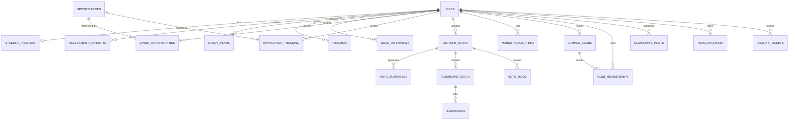

# PlacementPilot — Comprehensive Database Schema & Entity Relationships

> **Unified Platform Scope:** Placement Preparation + Academic AI Assistant + Campus Super-App  
> **Database:** PostgreSQL 16 (Normalized Relational Schema with SQLAlchemy 2.0 & Alembic)

---

## 1. Unified Entity Relationship Diagram (ERD)

---

## 2. Table Specifications by Subsystem

### Module A: Core Identity & Profiles
- `users`: `id`, `email`, `full_name`, `password_hash` (Argon2id), `role` (`student`, `admin`, `campus_staff`), `campus_name`, `is_active`, `created_at`, `updated_at`.
- `student_profiles`: `id`, `user_id`, `degree`, `branch`, `graduation_year`, `cgpa`, `skills`, `target_roles`, `preferred_locations`, `prep_hours_week`, `hostel_block`, `created_at`, `updated_at`.

### Module B: Placement Preparation Engine
- `questions`: `id`, `subject` (DSA, DBMS, OS, Networks, Aptitude), `topic`, `difficulty`, `question_text`, `question_type`, `options`, `correct_option` (hidden), `explanation`, `marks`, `is_active`.
- `assessments` & `assessment_questions`: `id`, `title`, `description`, `assessment_type`, `duration_mins`, `is_active`.
- `assessment_attempts` & `assessment_attempt_answers`: `id`, `user_id`, `assessment_id`, `started_at`, `submitted_at`, `total_score`, `max_score`, `percentage`, `status`.
- `study_plans` & `study_plan_tasks`: `id`, `user_id`, `target_role`, `title`, `start_date`, `end_date`, `status`; tasks with `scheduled_date`, `estimated_minutes`, `status` (`pending`, `completed`).
- `resumes`: `id`, `user_id`, `original_filename`, `storage_filename`, `file_size_bytes`, `extracted_skills`, `ats_score`, `feedback_json`, `created_at`.
- `mock_interviews`: `id`, `user_id`, `role`, `category`, `question_text`, `student_answer`, `technical_accuracy_score`, `feedback_json`, `is_ai_evaluated`, `created_at`.

---

### Module C: Feature 1 — AI Study Assistant 📚
Allows students to upload lecture PDFs/notes and generate summaries, flashcards, and practice questions.

#### 1. `lecture_notes`
| Column | Type | Constraints | Description |
|---|---|---|---|
| `id` | Integer | PRIMARY KEY, AUTO_INCREMENT | Note document ID |
| `user_id` | Integer | FOREIGN KEY (`users.id` ON DELETE CASCADE) | Owning student |
| `title` | VARCHAR(200) | NOT NULL | Note title (e.g., 'Operating Systems Lecture 5 - Deadlocks') |
| `subject` | VARCHAR(100) | NOT NULL | Course subject |
| `original_filename`| VARCHAR(255)| NOT NULL | Original upload name |
| `storage_filename` | VARCHAR(255)| NOT NULL, UNIQUE | Secure random UUID filename |
| `file_size_bytes` | INTEGER | NOT NULL | PDF size limit (<= 15MB) |
| `extracted_text` | TEXT | NOT NULL | Local PDF text extracted via `pypdf` |
| `page_count` | INTEGER | NOT NULL, DEFAULT 1 | Total PDF pages |
| `created_at` | TIMESTAMPTZ | NOT NULL, DEFAULT NOW() | Upload timestamp |

#### 2. `note_summaries`
| Column | Type | Constraints | Description |
|---|---|---|---|
| `id` | Integer | PRIMARY KEY, AUTO_INCREMENT | Summary ID |
| `note_id` | Integer | FOREIGN KEY (`lecture_notes.id` ON DELETE CASCADE) | Referenced note |
| `summary_type` | VARCHAR(50) | NOT NULL | 'executive', 'detailed', 'key_takeaways' |
| `summary_content` | TEXT | NOT NULL | Generated markdown summary |
| `is_ai_generated` | BOOLEAN | NOT NULL, DEFAULT FALSE | AI vs deterministic extraction |
| `created_at` | TIMESTAMPTZ | NOT NULL, DEFAULT NOW() | Timestamp |

#### 3. `flashcard_decks` & `flashcards`
- `flashcard_decks`: `id`, `note_id`, `user_id`, `title`, `card_count`, `created_at`
- `flashcards`: `id`, `deck_id`, `front_prompt`, `back_solution`, `mastery_level` (0-5), `last_reviewed_at`

#### 4. `note_mcqs`
- `id`, `note_id`, `question_text`, `options` (JSON), `correct_option`, `explanation`, `created_at`

---

### Module D: Feature 2 — Expanded Opportunity Hub 💼
Centralized directory for internships, hackathons, coding contests, research, and scholarships.

#### `opportunities`
| Column | Type | Constraints | Description |
|---|---|---|---|
| `id` | Integer | PRIMARY KEY, AUTO_INCREMENT | Listing ID |
| `category` | VARCHAR(50) | NOT NULL, INDEXED | `internship`, `hackathon`, `competition`, `research`, `scholarship`, `placement_prep` |
| `company_or_organizer`| VARCHAR(150)| NOT NULL | Organization / Company / University |
| `title` | VARCHAR(200) | NOT NULL | Job title, contest title, or grant name |
| `description` | TEXT | NOT NULL | Complete overview and deliverables |
| `required_skills` | JSONB / TEXT | NOT NULL, DEFAULT '[]' | Skills/prerequisites list |
| `eligibility_criteria`| TEXT | NOT NULL | Year, branch, CGPA, college rules |
| `target_graduation_years`| JSONB / TEXT| NOT NULL, DEFAULT '[]' | E.g. [2025, 2026] |
| `minimum_cgpa` | NUMERIC(4,2) | NULLABLE | Min CGPA required |
| `location` | VARCHAR(120) | NOT NULL | 'Remote', 'Bangalore', 'Campus', etc. |
| `prize_or_stipend` | VARCHAR(100) | NULLABLE | E.g. '₹45,000/mo' or '₹1,00,000 Prize Pool' |
| `application_url` | VARCHAR(500) | NOT NULL | Verified application link |
| `deadline` | TIMESTAMPTZ | NOT NULL, INDEXED | Last application date |
| `verification_status`| VARCHAR(30) | NOT NULL, DEFAULT 'unverified' | `verified`, `unverified`, `expired` |
| `created_at` | TIMESTAMPTZ | NOT NULL, DEFAULT NOW() | Listing date |

#### `saved_opportunities` & `application_tracking`
- `saved_opportunities`: `id`, `user_id`, `opportunity_id`, `saved_at`
- `application_tracking`: `id`, `user_id`, `opportunity_id`, `status` (`Interested`, `Applied`, `Shortlisted`, `Interview`, `Offer`, `Rejected`, `Withdrawn`), `notes`, `updated_at`

---

### Module E: Feature 3 — Campus Marketplace 🛒
Peer-to-peer student marketplace for textbooks, lab equipment, furniture, and tutoring.

#### `marketplace_items`
| Column | Type | Constraints | Description |
|---|---|---|---|
| `id` | Integer | PRIMARY KEY, AUTO_INCREMENT | Item listing ID |
| `seller_id` | Integer | FOREIGN KEY (`users.id` ON DELETE CASCADE) | Student seller |
| `campus_name` | VARCHAR(120) | NOT NULL, INDEXED | Restricts listings to user's campus |
| `title` | VARCHAR(180) | NOT NULL | E.g., 'Casio fx-991EX Scientific Calculator' |
| `category` | VARCHAR(50) | NOT NULL, INDEXED | `books`, `calculators_lab`, `furniture`, `tutoring`, `electronics`, `services` |
| `description` | TEXT | NOT NULL | Item condition, details, edition |
| `price` | NUMERIC(10,2)| NOT NULL | Selling price in INR (0.00 for free giveaway) |
| `condition` | VARCHAR(30) | NOT NULL | `brand_new`, `like_new`, `used_good`, `used_fair` |
| `contact_method` | VARCHAR(50) | NOT NULL | 'campus_email', 'phone', 'hostel_room' |
| `contact_details`| VARCHAR(255) | NOT NULL | E.g. 'Room B-304, Krishna Hostel' |
| `images_json` | JSONB / TEXT | DEFAULT '[]' | Array of sanitized image URLs |
| `status` | VARCHAR(30) | NOT NULL, DEFAULT 'available' | `available`, `reserved`, `sold`, `deactivated` |
| `created_at` | TIMESTAMPTZ | NOT NULL, DEFAULT NOW() | Listing timestamp |

---

### Module F: Feature 4 — Campus Community & Collaboration 🎓
Clubs discovery, hackathon teammate matchmaking, project showcases, and event announcements.

#### 1. `campus_clubs` & `club_memberships`
- `campus_clubs`: `id`, `lead_user_id`, `campus_name`, `name`, `category` (`coding`, `robotics`, `ai`, `cultural`, `design`), `description`, `logo_url`, `is_official`, `created_at`.
- `club_memberships`: `id`, `club_id`, `user_id`, `role` (`member`, `coordinator`, `lead`), `joined_at`.

#### 2. `community_posts`
| Column | Type | Constraints | Description |
|---|---|---|---|
| `id` | Integer | PRIMARY KEY, AUTO_INCREMENT | Post ID |
| `author_id` | Integer | FOREIGN KEY (`users.id` ON DELETE CASCADE) | Author |
| `campus_name` | VARCHAR(120) | NOT NULL | Campus scope |
| `post_type` | VARCHAR(50) | NOT NULL, INDEXED | `project_showcase`, `idea`, `event_announcement`, `general` |
| `title` | VARCHAR(200) | NOT NULL | Headline |
| `content` | TEXT | NOT NULL | Post body |
| `tags` | JSONB / TEXT | DEFAULT '[]' | E.g. ['React', 'MachineLearning', 'Hackathon'] |
| `created_at` | TIMESTAMPTZ | NOT NULL, DEFAULT NOW() | Publish timestamp |

#### 3. `team_requests` (Hackathon & Project Matchmaker)
| Column | Type | Constraints | Description |
|---|---|---|---|
| `id` | Integer | PRIMARY KEY, AUTO_INCREMENT | Teammate request ID |
| `creator_id` | Integer | FOREIGN KEY (`users.id` ON DELETE CASCADE) | Requesting student |
| `event_or_project_name`| VARCHAR(180)| NOT NULL | E.g. 'Smart India Hackathon 2026' |
| `roles_needed` | JSONB / TEXT | NOT NULL | E.g. ['UI/UX Designer', 'Backend Engineer'] |
| `description` | TEXT | NOT NULL | Team vision and requirements |
| `status` | VARCHAR(30) | NOT NULL, DEFAULT 'open' | `open`, `filled`, `closed` |
| `created_at` | TIMESTAMPTZ | NOT NULL, DEFAULT NOW() | Creation timestamp |

---

### Module G: Feature 5 — Hostel & Campus Services 🏠
Maintenance grievance ticketing and campus facilities tracking.

#### `facility_tickets`
| Column | Type | Constraints | Description |
|---|---|---|---|
| `id` | Integer | PRIMARY KEY, AUTO_INCREMENT | Ticket ID |
| `reporter_id` | Integer | FOREIGN KEY (`users.id` ON DELETE CASCADE) | Reporting student |
| `campus_name` | VARCHAR(120) | NOT NULL | Campus |
| `facility_area` | VARCHAR(80) | NOT NULL | `hostel`, `academic_block`, `lab`, `cafeteria`, `sports` |
| `block_or_building` | VARCHAR(100)| NOT NULL | E.g. 'Hostel Block 4 (Boys)', 'Ramanujan Block' |
| `room_or_location` | VARCHAR(100)| NOT NULL | E.g. '2nd Floor Water Cooler', 'Room 312' |
| `issue_category` | VARCHAR(60) | NOT NULL | `water`, `electricity`, `internet_wifi`, `carpentry`, `cleanliness` |
| `title` | VARCHAR(180) | NOT NULL | Brief summary (e.g. 'Broken water dispenser on 2nd floor') |
| `description` | TEXT | NOT NULL | Exact issue description |
| `urgency` | VARCHAR(20) | NOT NULL, DEFAULT 'medium' | `low`, `medium`, `high`, `emergency` |
| `status` | VARCHAR(30) | NOT NULL, DEFAULT 'open' | `open`, `acknowledged`, `in_progress`, `resolved`, `rejected` |
| `assigned_staff` | VARCHAR(120) | NULLABLE | Maintenance personnel name/contact |
| `resolution_notes`| TEXT | NULLABLE | Feedback upon resolution |
| `created_at` | TIMESTAMPTZ | NOT NULL, DEFAULT NOW() | Issue report timestamp |
| `resolved_at` | TIMESTAMPTZ | NULLABLE | Resolution timestamp |
